<picture>
  <source media="(prefers-color-scheme: dark)" srcset="assets/idle-escuro.svg">
  <source media="(prefers-color-scheme: light)" srcset="assets/idle-claro.svg">
  
</picture>

Oi, eu sou o Luiz Henrique 👋 Dev full stack há 8 anos, lá de São Miguel do Oeste/SC. Rust, TypeScript/Angular, Java/Spring e Dart/Flutter: escolho a ferramenta pelo problema (e às vezes pela vontade de escrever mais Rust).

Fora do teclado: jogos (os idle são os favoritos, jogam sozinhos enquanto eu trabalho) e finanças pessoais, que pensando bem também é um jogo idle.

<picture>
  <source media="(prefers-color-scheme: dark)" srcset="assets/terminal-escuro.svg">
  <source media="(prefers-color-scheme: light)" srcset="assets/terminal-claro.svg">
  
</picture>

### ⚔️ Quests em andamento

- **Carreto do Fim do Mundo**: jogo cooperativo 3D de física que roda no navegador.
- **Xucrutz**: um Discord só nosso, feito em Rust pros guri, com app desktop em Tauri + Angular.

<sub>Os dois ainda são privados. Quando sair da fase de testes, o link aparece aqui.</sub>

### 🏆 Placar de jogadores

<!-- PLACAR:INICIO -->
<sub>placar vazio. o primeiro jogador ganha a conquista secreta 👀</sub>
<!-- PLACAR:FIM -->

<sub>Quer entrar no placar? <a href="https://github.com/Zeeenrique/Zeeenrique/issues/new?title=%F0%9F%91%8B+oi&body=S%C3%B3+envia.+Um+rob%C3%B4+coloca+teu+avatar+no+placar+e+fecha+a+issue.">Deixa um oi</a>: um robô coloca teu avatar aqui em segundos.</sub>

<details>
<summary><sub>🎁 baú trancado (não abre)</sub></summary>

```
   você abriu o baú.
   recompensa: nenhuma. só a verdade:
   a tela lá em cima se atualiza sozinha todo dia via GitHub Actions,
   o terminal é um SVG animado gerado por script
   e o placar é um JSON que um robô edita.
   ou seja: eu não faço nada e os números sobem.
   é um jogo idle.
```

</details>
