<picture>
  <source media="(prefers-color-scheme: dark)" srcset="assets/fabrica-escuro.svg">
  <source media="(prefers-color-scheme: light)" srcset="assets/fabrica-claro.svg">
  
</picture>

<picture>
  <source media="(prefers-color-scheme: dark)" srcset="assets/letreiro-escuro.svg">
  <source media="(prefers-color-scheme: light)" srcset="assets/letreiro-claro.svg">
  
</picture>

Sou o Luiz Henrique, dev full stack há 8 anos, de Chapecó/SC. No meu chão de fábrica rodam Rust, TypeScript/Angular, Java/Spring e Dart/Flutter: escolho a máquina pelo serviço (e às vezes pela vontade de escrever mais Rust).

No intervalo: jogos idle, que produzem sozinhos enquanto eu trabalho, e planilha de finanças, que é basicamente o mesmo jogo com dinheiro de verdade.

### 📦 Em produção

| Produto | O que é | Status |
|---|---|---|
| **Carreto do Fim do Mundo** | jogo cooperativo 3D de física que roda no navegador | 🔧 em desenvolvimento |
| **Xucrutz** | um Discord só nosso, em Rust + Tauri/Angular, feito pros guri | 🔧 em desenvolvimento |

<sub>Linhas privadas por enquanto. Quando saírem da fábrica, o link aparece aqui.</sub>

### 🕐 Livro de ponto

<!-- PONTO:INICIO -->
<sub>ninguém bateu o ponto ainda. o primeiro ganha a vaga de funcionário do mês 👀</sub>
<!-- PONTO:FIM -->

<sub>Passou por aqui? <a href="https://github.com/Zeeenrique/Zeeenrique/issues/new?title=%F0%9F%95%90+bater+ponto&body=S%C3%B3+envia.+Um+rob%C3%B4+registra+teu+ponto+e+fecha+a+issue.">Bate o ponto</a> e um robô registra tua entrada em segundos.</sub>

<details>
<summary><sub>🔒 sala do gerente: acesso restrito</sub></summary>

```
   você entrou sem crachá.
   já que tá aqui, o segredo da firma:
   a fábrica lá em cima é um SVG que o GitHub Actions monta todo dia,
   o letreiro também,
   e o livro de ponto é um JSON que um robô preenche.
   o gerente (eu) não faz nada. a produção sobe igual.
```

</details>
